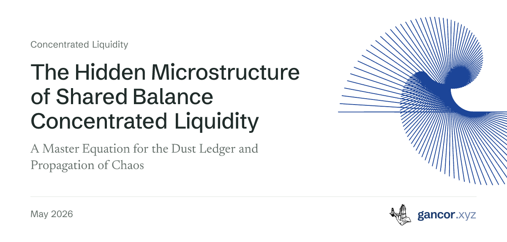

<p align="center">
  <picture>
    <source media="(prefers-color-scheme: dark)" srcset=".github/banner-dark.png" />
    <source media="(prefers-color-scheme: light)" srcset=".github/banner-light.png" />
    
  </picture>
</p>

# The Hidden Microstructure of Shared Balance Concentrated Liquidity

[](https://github.com/g4nc0r/hidden-microstructure/actions/workflows/lean.yml)
[](https://github.com/g4nc0r/hidden-microstructure/actions/workflows/foundry.yml)
[](https://doi.org/10.2139/ssrn.6745218)
[](https://doi.org/10.5281/zenodo.20115374)


Paper source, supplement, Lean formalisation, Foundry verification suite and model simulation for *The Hidden Microstructure of Shared Balance Concentrated Liquidity: A Master Equation for the Dust Ledger and Propagation of Chaos* (K. R. Ryan, 2026).

A manager of concentrated liquidity positions can keep what each rebalance leaves behind in one ledger, shared across the positions of a portfolio. The leftover of one position can then be drawn into a later mint of another position that holds the same token, and the ledger becomes a state that couples the positions. The paper studies that state at three levels. The first is exact: the change of the ledger at any rebalance, which token is left and what it is worth, and conservation and transfer identities across positions. The second is a model of N pools that share one token, with one position in each, in which the stationary ledger balances of the pools' other tokens become independent as N grows, at rate 1/N, and each is exactly zero with a probability given in closed form. The third sets the model against an exact simulation of the contract and against the chain record of one manager on Base, and reports where it holds and where it does not.

The paper extends [*The Geometric Siphon*](https://github.com/g4nc0r/the-geometric-siphon) from one rebalance of one position to a ledger shared over many.

## Where to start

| If you want to | Go to |
|---|---|
| Read the paper | [`paper/master-equation.pdf`](./paper/master-equation.pdf), or [SSRN 6745218](https://doi.org/10.2139/ssrn.6745218) |
| Read the supplement | [`supplement/`](./supplement/): simulation tables, the test suite scenario by scenario, and the proofs of Propositions 4 and 5 and Lemma 3 |
| See what changed from the May and July 2026 versions | [`paper/changes-from-earlier-versions.pdf`](./paper/changes-from-earlier-versions.pdf) |
| Check the proofs | [`lean/`](./lean/), 136 machine-checked statements |
| Check the arithmetic against live pools | [`foundry/`](./foundry/), 24 tests, 12 on a Base fork against two position managers |
| Run the model of §6 | [`simulation/`](./simulation/), the kernel under three residual laws, against the exact values of §6 and the tables of §7.1 |

## What is checked where

| Result | Paper | Lean | Foundry, integer model | Foundry, Base fork |
|---|---|---|---|---|
| Theorem 1, the jump of the ledger | §4.1 | [`MasterJump`](./lean/MasterEquation/MasterJump.lean) | 8 tests | 4 tests on each manager |
| Proposition 1, binding-side criterion | §5.1 | [`BindingSide`](./lean/MasterEquation/BindingSide.lean) | 1 test | 1 test on each manager, with Corollary 2 |
| Corollary 1, swap-free rule | §5.1 | [`BindingSide`](./lean/MasterEquation/BindingSide.lean) | 2 tests | |
| Corollary 2, swap-corrected rule | §5.1 | [`BindingSide`](./lean/MasterEquation/BindingSide.lean) | 1 test | the same test |
| Theorem 2, conservation without a swap | §5.2 | [`Conservation`](./lean/MasterEquation/Conservation.lean) | none, by design | 1 test on each manager |
| Lemma 1, transfers between positions | §5.2 | [`Transfers`](./lean/MasterEquation/Transfers.lean) | | |
| The kernel of the model | §6.1 | [`DirectionKernel`](./lean/MasterEquation/DirectionKernel.lean), derived from Theorem 1 | | |
| Lemma 2, stationary law | §6.1 | [`DirectionKernel`](./lean/MasterEquation/DirectionKernel.lean), the steps at one event only | | |
| Proposition 2, independence at rate 1/N | §6.1 | [`DirectionKernel`](./lean/MasterEquation/DirectionKernel.lean), the first step of the proof only | | |
| Proposition 3, the atom at zero, and its Gaussian case | §6.1 | [`DirectionKernel`](./lean/MasterEquation/DirectionKernel.lean), [`SpokeMarginal`](./lean/MasterEquation/SpokeMarginal.lean), [`GaussianMoment`](./lean/MasterEquation/GaussianMoment.lean), the identity at one event | | |
| Proposition 4, unequal spokes | §6.2 | not formalised | | |
| Proposition 5, a common direction | §6.2 | not formalised | | |
| Lemma 3, zero indicators | §6.2 | not formalised | | |
| Proposition S1, position size | supplement §7.4 | [`DirectionKernel`](./lean/MasterEquation/DirectionKernel.lean), parts (i) and (iii); (ii) and (iv) given the conditional means | | |

The Lean proofs are in real arithmetic. The Foundry suite is the check against the integer arithmetic of the pool, and its fork tests state every prediction of Theorem 1 and compare it with the outcome by equality, to the base unit, on Aerodrome Slipstream and on Uniswap V3. The fork tests of Proposition 1 compare the value left with the proposition's expression to within 3%, the difference being the pool's fee and the swap's price impact, and those of Theorem 2 allow each total to fall by the one base unit a mint keeps. Theorem 2 has no test on the integer model because without custody of tokens it is an identity of the test's own bookkeeping.

The statements of §6 concern laws over many rebalances. They are proved in the paper and the supplement, and tested there by simulation and by replays of the chain record. Lean covers what holds at a single event. What each Lean file covers, and what it leaves out, is listed in [`lean/README.md`](./lean/README.md).

## Paper

| Version | Where | Status |
|---|---|---|
| The Hidden Microstructure of Shared Balance Concentrated Liquidity | [`paper/`](./paper/), [SSRN 6745218](https://papers.ssrn.com/sol3/papers.cfm?abstract_id=6745218) | Live preprint, revised November 2026 |
| The same, version of July 2026 | repository history, commit `a39d5ef` | Replaced by the revision |
| The same, version of May 2026 | repository history, tag `v1.0.0` | Replaced by the version of July 2026 |

The November 2026 revision follows the revision of *The Geometric Siphon* and a check of this paper's own evidence against on-chain events. It differs from the versions of May and July 2026 in three main ways.

- **Evidence.** Earlier versions read ranges and displacements from the operator's rebalance log. This version reads its token quantities from chain events: 152,719 rebalances, on 150,357 of which the per-event identity of Theorem 1 closes to the wei.
- **Proposition 1.** It was a sign-keyed correlation, given as a form of the prior paper's Connector Rule. It is now a statement about the token one rebalance leaves, with a rule for the swap-free case and one for the swap-corrected case, and makes no claim about connectivity.
- **The model.** Proposition 2 was conditional on two assumptions, (A4) and (A5). It is now proved from the kernel at rate 1/N. (A4) is not needed. (A5) was stated in total variation and does not hold in that form; an identity in ℓ¹, which is proved, takes its place. The kernel is written by direction, since the earlier assignment of sides did not follow from Theorem 1. Unequal spokes, a conjecture before, is Proposition 4 under a condition on the sizes.

[`paper/changes-from-earlier-versions.pdf`](./paper/changes-from-earlier-versions.pdf) lists the principal statements that differ, with their earlier and present forms, and says where an earlier statement was wrong. One renumbering to note: Corollary 1 was the half-normal mixture and is now the swap-free rule.

## Quick start

```bash
# Lean: build and audit (first run fetches prebuilt mathlib, several GB)
cd lean
lake exe cache get && lake build
lake env lean AxiomCheck.lean
cd ..

# Foundry: 12 tests on the integer pool model, no network (from the repository root)
cd foundry
git submodule update --init --recursive
forge test --no-match-contract Fork

# Foundry: all 24 tests, 12 against Aerodrome Slipstream and Uniswap V3 on a Base fork
RPC_BASE_ALCHEMY=https://mainnet.base.org forge test
cd ..

# Simulation of the model: exact check, then the tables (needs NumPy)
cd simulation
python3 check_exact.py
python3 reproduce.py --quick
```

## Layout

```
.
├── paper/              current paper (.pdf, .tex), changes from earlier versions, with a README
├── supplement/         supplement to the paper (.pdf, .tex, one figure), with a README
├── lean/               Lean 4 formalisation
│   ├── MasterEquation/   shared definitions and seven result files
│   ├── AxiomCheck.lean   axiom audit, 136 statements
│   └── README.md         coverage by paper result, and scope
├── foundry/            Foundry verification suite
│   ├── src/              two reference position managers, two mock pools, interfaces
│   ├── test/             8 test contracts in 4 files, and helpers
│   ├── PROOF_OUTPUT.md   captured forge output, by statement, with a table of deliberate faults
│   └── README.md
├── simulation/         the model chain of §6 in Python
│   ├── kernel.py, laws.py   the kernel, three residual laws and their exact constants
│   ├── reproduce.py, check_exact.py
│   └── README.md
├── CITATION.cff
├── LICENSE
└── README.md
```

## Lean formalisation

[`lean/`](./lean/) holds machine-checked proofs in Lean 4 against mathlib. Theorems 1 and 2, Proposition 1 with Corollaries 1 and 2, and Lemma 1 are proved in full. For the model, the kernel is derived from Theorem 1 and what follows from it at a single event is proved: the steps on which Lemma 2 rests, the identity behind the atom of Proposition 3, the first step of the proof of Proposition 2, and parts of Proposition S1. The stationary law, the rate of Proposition 2, Propositions 4 and 5 and Lemma 3 are not formalised. The axiom audit covers 136 statements, each depending only on `propext`, `Classical.choice` and `Quot.sound`.

## Foundry verification suite

[`foundry/`](./foundry/) holds 24 tests across 8 contracts, covering Theorems 1 and 2 and Proposition 1 with its corollaries. Twelve run on an integer model of a V3 mint and burn with no network access. Twelve run on a Base fork pinned to block `43_175_000` (10 March 2026, 10:42 UTC), six against the unmodified Aerodrome Slipstream position manager and six against the unmodified Uniswap V3 one, each wrapped by a reference manager that adds the shared ledger. The fork tests of Theorem 1 predict the liquidity minted and both ledger entries and compare by equality, before the transaction where there is no swap and from the swap's own event where there is one. The continuous-integration badge covers the twelve network-free tests. Any Base RPC with archive support works in `RPC_BASE_ALCHEMY`. The captured output, and which tests fail under each of twelve deliberate faults, are in [`foundry/PROOF_OUTPUT.md`](./foundry/PROOF_OUTPUT.md).

## Simulation

[`simulation/`](./simulation/) holds the hub-spoke kernel of §6 and the three synthetic residual laws of §7.1 (Gaussian, uniform, skewed), in Python with NumPy. One script checks the float kernel against the same rule in exact rational arithmetic, with the side rule, the bound on the balances and the ℓ¹ identity behind Lemma 2 asserted at every event. Another reproduces, at laptop scale, the mass at zero against *q*, the mean balances and the covariances against their exact values, the dependence between spokes at order 1/*N*, the Gaussian case against the half-normal law, and the contraction rate against Lemma 2. Lean does not cover these laws, so this is the check of them a reader can run. See [`simulation/README.md`](./simulation/README.md).

## Supplement

[`supplement/`](./supplement/) holds material the paper cites and does not print: the tables behind its simulations, the steps of the leftover by portfolio, the first set of replays, the test suite scenario by scenario, the coverage of the formalisation statement by statement, the proofs of Propositions 4 and 5 and Lemma 3, and the statement on position size with its proof (Proposition S1).

## What is not here

The chain record of §8 is derived from public contract and pool events on Base. Its derived files, the residual law measured on it, the simulations of the contract of §7.2, the replay scripts and the test specifications fixed in advance are not published. The exact engine that the contract simulations extend is in the repository of *The Geometric Siphon*, under `simulator/`.

## Citation

Cite the preprint. A `CITATION.cff` with the same metadata is at the repository root.

<details>
<summary>BibTeX</summary>

```bibtex
@techreport{ryan2026hiddenmicrostructure,
  author      = {Ryan, K. R.},
  title       = {The Hidden Microstructure of Shared Balance Concentrated
                 Liquidity: A Master Equation for the Dust Ledger and
                 Propagation of Chaos},
  institution = {SSRN},
  number      = {6745218},
  year        = {2026},
  doi         = {10.2139/ssrn.6745218},
  url         = {https://papers.ssrn.com/sol3/papers.cfm?abstract_id=6745218}
}

@techreport{ryan2026siphon,
  author      = {Ryan, K. R.},
  title       = {The Geometric Siphon: Existence, Equilibrium, and Directional
                 Properties of the Residual in Concentrated Liquidity
                 Portfolios},
  institution = {SSRN},
  number      = {6686798},
  year        = {2026},
  doi         = {10.2139/ssrn.6686798},
  url         = {https://papers.ssrn.com/sol3/papers.cfm?abstract_id=6686798}
}
```

</details>

## Author and licence

| | |
|---|---|
| **Author** | K. R. Ryan, independent researcher |
| **Contact** | [gancor.xyz](https://gancor.xyz) · ORCID [0009-0004-6295-7040](https://orcid.org/0009-0004-6295-7040) · code and reproduction questions via [GitHub Issues](https://github.com/g4nc0r/hidden-microstructure/issues) |
| **Licence** | code MIT (`LICENSE`); paper and supplement PDFs and LaTeX sources © K. R. Ryan, all rights reserved |
